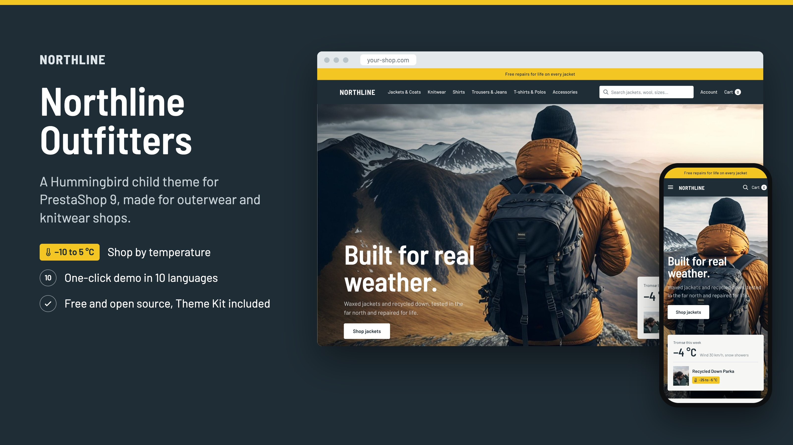
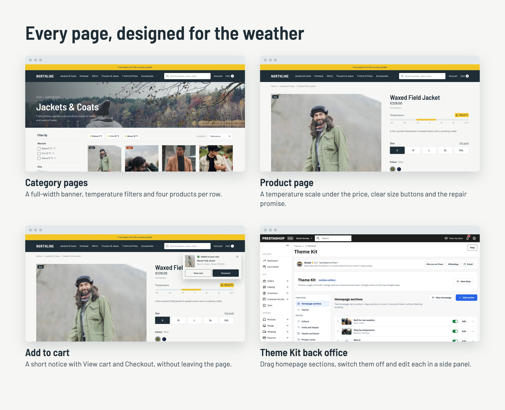
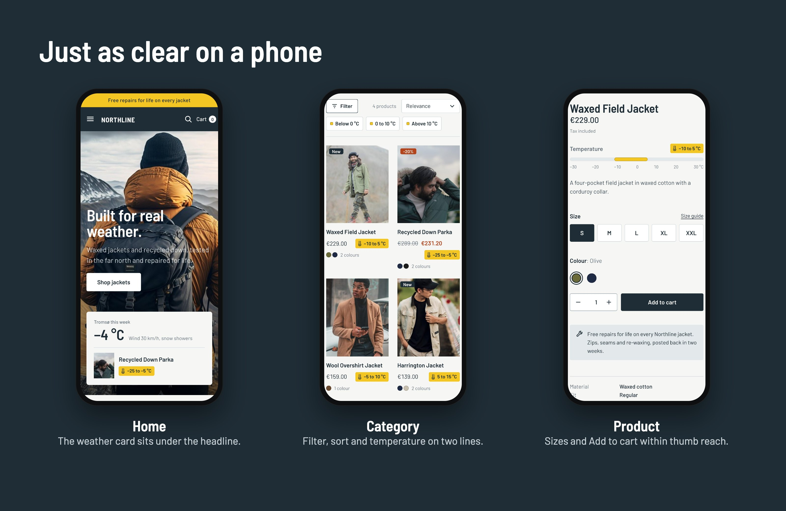

# Northline Outfitters: Free PrestaShop 9 Theme for Outdoor Clothing Stores

Northline Outfitters is a free PrestaShop 9 theme for outdoor clothing, outerwear and knitwear shops. It is a responsive Hummingbird child theme with a temperature rating on every product, temperature filters, AJAX add to cart with a short notice, a one-click demo in 10 languages and the free Hummingbird Theme Kit module.

**[Live demo](https://iamshoaibktk.github.io/prestashop-theme-northline-outfitters/)** | **[Download the free theme](https://github.com/iamshoaibktk/prestashop-theme-northline-outfitters/releases/latest)**

## Features of this free PrestaShop 9 theme

- **Shop by temperature**: every product carries a temperature rating, shown as a tag on product cards, a scale on the product page and quick temperature filters on category pages.
- **AJAX add to cart**: a short notice with View cart and Checkout, a loading state and a check mark on the button, and the photo flying to the cart. Pick a card style with a button and customers choose the size right on the product card.
- **Search with live results**: a header search field that lists products with their photo, price and temperature while the customer types.
- **Repairs-for-life story** on the homepage and product page, plus a weather card on the hero image.
- **Child theme of Hummingbird** (`parent: hummingbird`). No parent templates are copied, so Hummingbird and PrestaShop updates keep working.
- **Hummingbird Theme Kit module** (`hbkit` v1.1.0): colours, fonts, corners, header and footer style as CSS variables, a top bar, and a homepage builder (banners, faq, hero, image text, products, testimonials).
- **Page layouts you can switch in the back office**: side cart, cart page, category pages, product page and product cards, each with several picture-chosen styles. This demo uses: small add-to-cart notice; classic cart page; filters in the left column; category title on a banner image; classic product page; details in an accordion; 4 products per row; label product cards.
- **One-click demo import**: 24 products with sizes/colours and features, 6 categories, brands, 8 CMS pages, main menu, footer links, reassurance blocks and 6 homepage sections.
- **10 languages** for everything: English, French, Spanish, Italian, Polish, German, Czech, Dutch, Portuguese, Russian.
- Self-hosted fonts (SIL Open Font License), no external font or tracking calls.

## Requirements

- PrestaShop 9.2 or newer with the Hummingbird theme (installed by default)
- PHP 8.1+

## Installation

1. Download the release files: `northline-outfitters-theme-v1.0.0.zip` and `hbkit-v1.1.0.zip`.
2. **Modules > Module Manager > Upload a module**: upload `hbkit-v1.1.0.zip`.
3. **Design > Theme & Logo > Add new theme**: upload `northline-outfitters-theme-v1.0.0.zip`, then click *Use this theme*.
4. **Design > Theme Kit > Demo import**: pick *Northline Outfitters*, type `IMPORT` and click *Import this demo*.
   On a fresh shop keep *Remove existing content first* checked. Orders and customers are never touched.
5. Adjust colours, fonts and page layouts in **Theme Kit > Design**, and every homepage section in **Theme Kit > Homepage sections**.

## Customising safely

- Put your CSS in `themes/northline-outfitters/assets/css/custom.css`.
- Colours, fonts, spacing and page layouts are settings in Theme Kit > Design; no template edits needed.
- To change a template, copy only the block you need with `{extends file='parent:...'}` instead of copying the whole file.

## Credits

- Photos: see [CREDITS.md](CREDITS.md) (Pixabay Content License).
- Fonts: SIL Open Font License 1.1 (licence files in `theme/northline-outfitters/assets/fonts/`).
- Northline Outfitters and its brands are fictional and created for this demo.

## Frequently asked questions

**Is Northline Outfitters free?**
Yes. It is a free and open-source PrestaShop theme under the AFL-3.0 licence. You can use it on personal and commercial shops.

**Which PrestaShop versions does it support?**
PrestaShop 9.2 and newer, with PHP 8.1 or newer. It is a child theme of Hummingbird, the default theme of PrestaShop 9.

**Will PrestaShop or Hummingbird updates break it?**
No parent template is copied. The theme only adds its own styles and the few templates it changes, so updates to Hummingbird and PrestaShop keep working.

**Which languages are included?**
All texts and the demo content come in 10 languages: English, French, Spanish, Italian, Polish, German, Czech, Dutch, Portuguese, Russian.

**Can I use it for a different kind of shop?**
Yes. It is made for a outdoor clothing store, but colours, fonts, page layouts and every homepage section are settings in Theme Kit, and the demo content can be removed.

**Can I see it before installing?**
Yes: the [live demo](https://iamshoaibktk.github.io/prestashop-theme-northline-outfitters/) is a static copy of the demo store. The cart, account and search work once the theme is installed on PrestaShop.

**Where can I get help, or a custom PrestaShop theme or module?**
Contact the author below: installation help, custom demos and PrestaShop modules.

## Licence

Academic Free License 3.0 (AFL-3.0), see [LICENSE.md](LICENSE.md).

## More free PrestaShop 9 themes

- [Maison Vellor](https://github.com/iamshoaibktk/prestashop-theme-maison-vellor): free PrestaShop 9 theme for fashion boutiques
- [Little Sprout](https://github.com/iamshoaibktk/prestashop-theme-little-sprout): free PrestaShop 9 theme for baby and kids' clothing stores
- [Stride Atelier](https://github.com/iamshoaibktk/prestashop-theme-stride-atelier): free PrestaShop 9 theme for shoe and sneaker stores

## Author & support

Muhammad Shoaib — iamshoaibktk@gmail.com · WhatsApp +923459016286 · [Fiverr](https://www.fiverr.com/shoaibktk)
Need installation help, a custom demo or a PrestaShop module? Get in touch.
