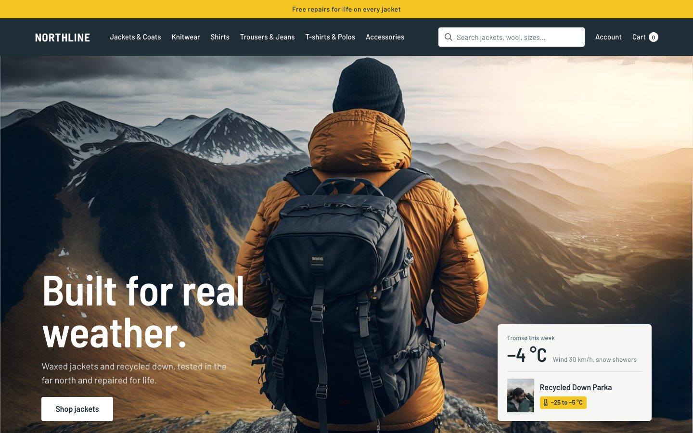
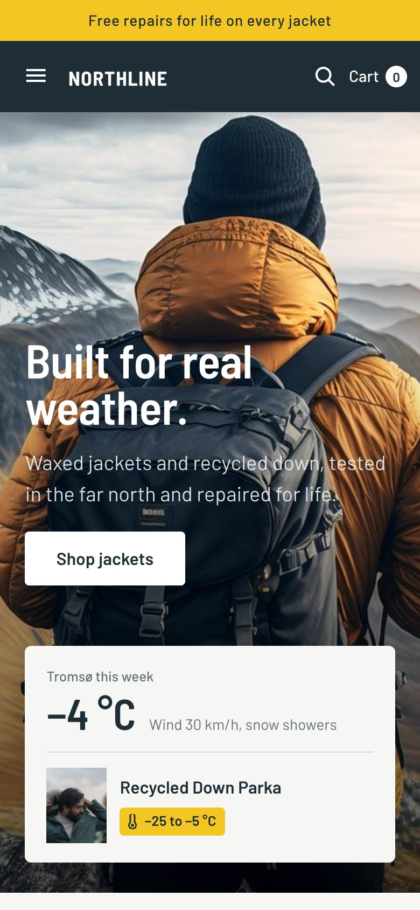
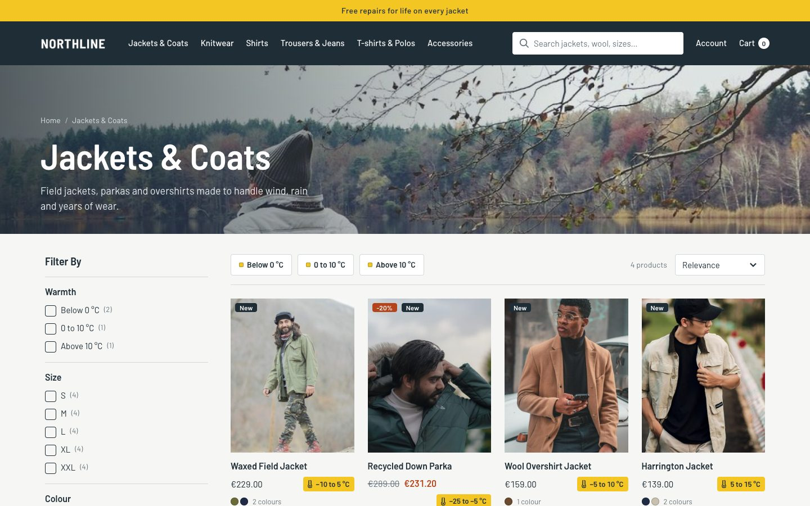
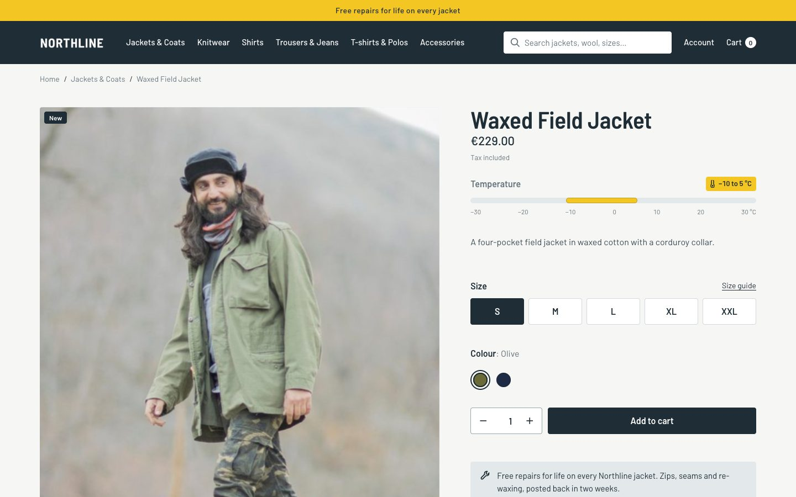
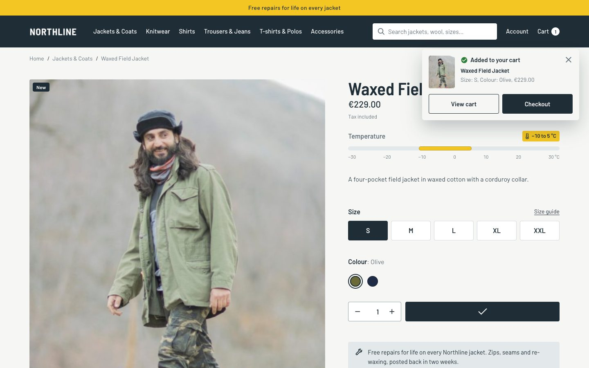

# Northline Outfitters — Hummingbird child theme for PrestaShop 9

Men's outerwear and knitwear for Nordic weather: every product carries a temperature rating, and every jacket is repaired for life.

**Live preview:** https://iamshoaibktk.github.io/prestashop-theme-northline-outfitters/
(static preview of the demo store; cart, account and search work once installed on PrestaShop)

| Mobile | Category | Product | Add to cart |
|---|---|---|---|
|  |  |  |  |

## What you get

- **Child theme of Hummingbird** (`parent: hummingbird`). No parent templates are copied, so Hummingbird and PrestaShop updates keep working.
- **Hummingbird Theme Kit module** (`hbkit` v1.1.0): colours, fonts, corners, header and footer style as CSS variables, a top bar, and a homepage builder (banners, faq, hero, image text, products, testimonials).
- **Page layouts you can switch in the back office**: side cart, cart page, category pages, product page and product cards, each with several picture-chosen styles. This demo uses: small add-to-cart notice; classic cart page; filters in the left column; category title on a banner image; classic product page; details in an accordion; 4 products per row; label product cards.
- **One-click demo import**: 24 products with sizes/colours and features, 6 categories, brands, 8 CMS pages, main menu, footer links, reassurance blocks and 6 homepage sections.
- **10 languages** for everything: English, French, Spanish, Italian, Polish, German, Czech, Dutch, Portuguese, Russian.
- Self-hosted fonts (SIL Open Font License), no external font or tracking calls.

## Requirements

- PrestaShop 9.2 or newer with the Hummingbird theme (installed by default)
- PHP 8.1+

## Installation

1. Download the release files: `northline-outfitters-theme-v1.0.0.zip` and `hbkit-v1.1.0.zip`.
2. **Modules > Module Manager > Upload a module**: upload `hbkit-v1.1.0.zip`.
3. **Design > Theme & Logo > Add new theme**: upload `northline-outfitters-theme-v1.0.0.zip`, then click *Use this theme*.
4. **Design > Theme Kit > Demo import**: pick *Northline Outfitters*, type `IMPORT` and click *Import this demo*.
   On a fresh shop keep *Remove existing content first* checked. Orders and customers are never touched.
5. Adjust colours, fonts and page layouts in **Theme Kit > Design**, and every homepage section in **Theme Kit > Homepage sections**.

## Customising safely

- Put your CSS in `themes/northline-outfitters/assets/css/custom.css`.
- Colours, fonts, spacing and page layouts are settings in Theme Kit > Design; no template edits needed.
- To change a template, copy only the block you need with `{extends file='parent:...'}` instead of copying the whole file.

## Credits

- Photos: see [CREDITS.md](CREDITS.md) (Pixabay Content License).
- Fonts: SIL Open Font License 1.1 (licence files in `theme/northline-outfitters/assets/fonts/`).
- Northline Outfitters and its brands are fictional and created for this demo.

## Licence

Academic Free License 3.0 (AFL-3.0), see [LICENSE.md](LICENSE.md).

## Author & support

Muhammad Shoaib — iamshoaibktk@gmail.com · WhatsApp +923459016286 · [Fiverr](https://www.fiverr.com/shoaibktk)
Need installation help, a custom demo or a PrestaShop module? Get in touch.
